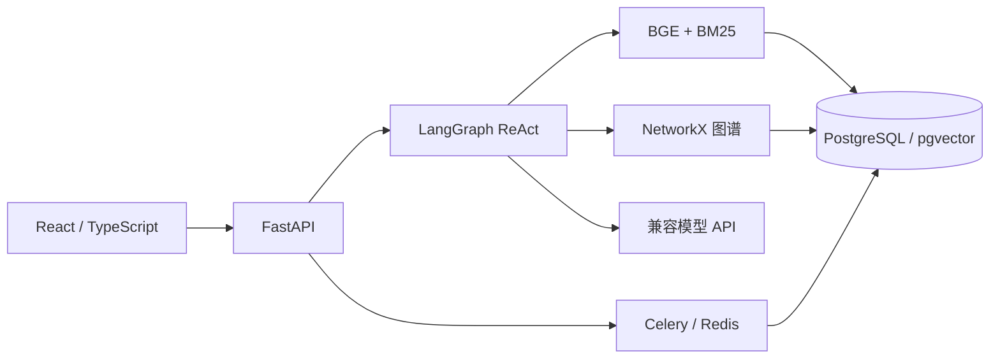

# 数学人物知识分析 · MathKnow

面向数学人物传记、研究领域和师承关系的知识分析与问答系统。基于 ReAct Agent、混合检索和人物关系图谱，支持原文检索、多轮问答、关系查询及可追溯引用。

## 功能

- **ReAct 工具循环**：模型选择人物资料、原文检索、关系邻居、路径或领域/籍贯查询工具，观察结果后继续查询或回答。
- **混合检索**：BGE 向量 + BM25，支持加权融合、RRF 与可选精排。
- **图谱分析**：人物属性、有向师承关系、无向连接路径、领域/籍贯匹配和分页名单。
- **可追溯回答**：真实模型 SSE 输出、引用编号、查询范围和实际命中数；空查询不作为正向引用证据。
- **知识管理**：TXT、Markdown、可提取文字的 PDF 上传，异步摄取、任务重试、删除及索引版本更新。
- **交互界面**：React/TypeScript、Markdown/KaTeX、历史会话与工具轨迹回看、自适应布局。

## 架构



默认轻量模式使用 SQLite、内存向量、hash 编码和离线摘录，方便验证交互；真实 ReAct 需要配置外部模型。完整模式使用 PostgreSQL/pgvector、Redis、Celery 和本地 BGE。旧固定工作流保留为可选执行器对照。

## 本地运行

Python 3.11+，Node.js 22+。在项目目录运行：

```powershell
python -m venv .venv
.\.venv\Scripts\python.exe -m pip install -e ".[dev,prod]"
Copy-Item .env.example .env
cd frontend
npm ci
npm run build
cd ..
.\.venv\Scripts\python.exe scripts/run_api.py
```

打开 http://127.0.0.1:8010/web/ ，接口文档为 http://127.0.0.1:8010/docs 。前端开发可在 frontend 执行 npm run dev，代理到 8010。

轻量配置不会调用收费模型。配置真实模型时在本机 .env 设置 MATHKB_LLM__PROVIDER=openai、MATHKB_LLM__BASE_URL、MATHKB_LLM__MODEL、MATHKB_LLM__API_KEY；不要把密钥提交到仓库或填写到网页的应用令牌输入框。真实问答会把检索片段发送给所配置服务商。

BGE 需要安装 requirements-ml.txt，下载模型并设置 MATHKB_EMBEDDING__PROVIDER=bge 和 MATHKB_EMBEDDING__CACHE_DIR。模型权重与完整传记原文不随仓库发布。

## PostgreSQL / Redis / Celery

```powershell
Copy-Item .env.production.example .env.production
# 修改本地密码与访问令牌，然后启动
 docker compose --env-file .env.production up --build -d
 docker compose --env-file .env.production exec api python scripts/check_stack.py --require-all
```

容器入口 http://127.0.0.1:8080/web/ 。默认容器先用 hash / stub 验证存储与队列；接入真实 BGE 需安装 ML 依赖并挂载模型缓存。迁移由 Alembic 执行，数据库和 Redis 只在容器网络内使用。部署配置不等于已完成生产上线。

## 数据与验证

仓库包含 data/seed 样例语料、图谱与回归用例，data/full/kg 和 data/full/qa 提供全量结构化图谱及评测辅助数据。完整传记原文由使用者按来源授权自行准备，使用 MATHKB_BIOGRAPHIES_DIR 指定；模型、索引、会话、上传文件与密钥均被忽略。

```powershell
.\.venv\Scripts\python.exe -m pytest -q
.\.venv\Scripts\python.exe scripts/smoke_test.py
.\.venv\Scripts\python.exe scripts/run_eval.py --skip-mcq --out reports/eval.json
```

MATHKB_TEST_POSTGRES_URL 启用真实 pgvector 集成测试，使用独立 collection 并清理；未配置时该项跳过。评测样本为自动生成的弱标注，只适合回归，不代表真实用户满意率。完整传记内容和样例资料的来源信息保留在数据中。

## 文档

- [ReAct 机制](docs/ReAct机制.md)
- [架构与数据流](docs/架构说明.md)
- [数据说明](docs/数据说明.md)
- [部署说明](docs/部署说明.md)

此仓库仅包含数学人物知识分析相关实现和技术文档。
