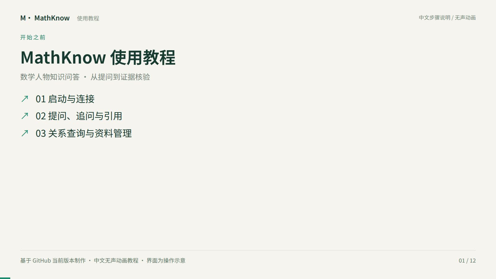
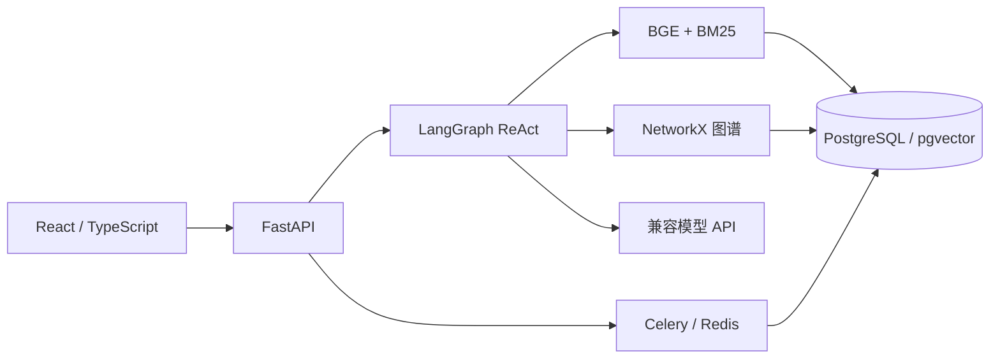

# 数学人物知识分析 · MathKnow

面向数学人物传记、研究领域和师承关系的知识分析与问答系统。基于 ReAct Agent、混合检索和人物关系图谱，支持原文检索、多轮问答、关系查询及可追溯引用。

## 使用教程视频

[](docs/media/mathknow-tutorial.mp4)

▶ **[观看使用教程（MP4，2 分钟）](docs/media/mathknow-tutorial.mp4)** · [直接下载视频](https://raw.githubusercontent.com/wuyien-coder/newnew/main/docs/media/mathknow-tutorial.mp4) · [文字教程与章节导航](docs/使用教程.md)

中文无声动画教程，涵盖本地启动、连接设置、提问、引用核验、人物关系查询、历史会话和文档上传。画面为依据当前版本制作的操作示意；离线摘录与真实模型模式已分别说明。若 GitHub 未显示播放器，请下载后观看。

## 功能

- **ReAct 工具循环**：模型选择人物资料、原文检索、关系邻居、路径或领域/籍贯查询工具，观察结果后继续查询或回答。
- **混合检索**：BGE 向量 + BM25，支持加权融合、RRF 与可选精排。
- **图谱分析**：人物属性、有向师承关系、无向连接路径、领域/籍贯匹配和分页名单。
- **可追溯回答**：真实模型 SSE 输出、引用编号、查询范围和实际命中数；空查询不作为正向引用证据。
- **知识管理**：TXT、Markdown、可提取文字的 PDF 上传，异步摄取、任务重试、删除及索引版本更新。
- **交互界面**：React/TypeScript、Markdown/KaTeX、历史会话与工具轨迹回看、自适应布局。

## 架构



仓库现在附带与本地完整版逐文件一致的全部语料：326 份传记文件、9,921 个文本块、335 条人物记录与 355 条关系。默认数据目录为 data/full。默认离线模式使用 SQLite、内存向量、hash 编码和离线摘录；接入真实 ReAct、BGE、PostgreSQL/pgvector、Redis、Celery 请使用下面的完整版部署流程。旧固定工作流保留为可选执行器对照。

326 份文件包含同一人物的多篇传记，解析后有 265 个不同传记姓名。图谱与传记存在别名和收录范围差异；有图谱记录不代表有对应全文。此版本恢复本地已有资料覆盖，不承诺回答资料中未记载的问题。精确覆盖与文件校验值见 data/full/manifest.json。

## 与本地一致的完整版

安装 Docker Compose 和 Python 3.11+。在项目目录执行：

```powershell
python -m venv .venv
.\.venv\Scripts\python.exe -m pip install -e ".[prod,ml]"
Copy-Item .env.full.example .env.full
# 编辑 .env.full，填写 MATHKB_LLM__API_KEY，并修改数据库密码和应用访问令牌。
.\.venv\Scripts\python.exe scripts/verify_corpus.py
.\.venv\Scripts\python.exe scripts/download_models.py
docker compose --env-file .env.full -p mathknow-full -f docker-compose.yml -f docker-compose.full.yml up --build -d
docker compose --env-file .env.full -p mathknow-full -f docker-compose.yml -f docker-compose.full.yml exec api python scripts/check_stack.py --require-all
```

打开 http://127.0.0.1:8080/web/ ，在页面连接设置填写 .env.full 中的应用访问令牌。模型 API 密钥保留在 .env.full。已有 BGE 缓存时，可把 MODEL_CACHE_DIR 设为该目录，跳过模型下载。首次建库会处理全部文本并生成 BGE 向量，需要等待；后续启动复用向量缓存。

完整版提供真实模型 ReAct、多轮会话、SSE 流式回答、原文引用、混合检索、图谱关系与路径查询，以及 TXT/Markdown/PDF 上传、Celery 异步摄取和删除。完整原文随 GitHub 仓库与镜像提供，模型权重通过下载脚本准备，访问服务所需密钥由使用者填写。

## 本地运行

Python 3.11+，Node.js 22+。在项目目录运行：

```powershell
python -m venv .venv
.\.venv\Scripts\python.exe -m pip install -e ".[dev,prod]"
Copy-Item .env.example .env
cd frontend
npm ci
npm run build
cd ..
.\.venv\Scripts\python.exe scripts/run_api.py
```

打开 http://127.0.0.1:8010/web/ ，接口文档为 http://127.0.0.1:8010/docs 。前端开发可在 frontend 执行 npm run dev，代理到 8010。

轻量配置不会调用收费模型。配置真实模型时在本机 .env 设置 MATHKB_LLM__PROVIDER=openai、MATHKB_LLM__BASE_URL、MATHKB_LLM__MODEL、MATHKB_LLM__API_KEY；不要把密钥提交到仓库或填写到网页的应用令牌输入框。真实问答会把检索片段发送给所配置服务商。

BGE 需要安装 requirements-ml.txt，下载模型并设置 MATHKB_EMBEDDING__PROVIDER=bge 和 MATHKB_EMBEDDING__CACHE_DIR。完整传记原文已随仓库发布；模型权重用 scripts/download_models.py 准备。若只需原来的小样例，可复制 .env.seed.example 为 .env，并使用独立数据库。

## PostgreSQL / Redis / Celery

```powershell
Copy-Item .env.production.example .env.production
# 修改本地密码与访问令牌，然后启动
 docker compose --env-file .env.production up --build -d
 docker compose --env-file .env.production exec api python scripts/check_stack.py --require-all
```

容器入口 http://127.0.0.1:8080/web/ 。默认容器先用 hash / stub 验证存储与队列；接入真实 BGE 需安装 ML 依赖并挂载模型缓存。迁移由 Alembic 执行，数据库和 Redis 只在容器网络内使用。部署配置不等于已完成生产上线。

## 数据与验证

仓库包含 data/seed 样例，以及 data/full/biographies 全部本地传记、data/full/kg 全量结构化图谱、data/full/qa 评测辅助数据。模型、索引、会话、上传文件与密钥均被忽略。原始资料的权利与来源信息保留在数据中。

若已有数据库只加载了样例，修改 MATHKB_DATA_DIR 后运行 `python scripts/build_index.py --sync-corpus`，补齐传记及图谱并重建索引；该命令保留原会话和上传资料。单独使用 --force 仅重算向量，不切换数据集。

```powershell
.\.venv\Scripts\python.exe -m pytest -q
.\.venv\Scripts\python.exe scripts/smoke_test.py
.\.venv\Scripts\python.exe scripts/run_eval.py --skip-mcq --out reports/eval.json
```

MATHKB_TEST_POSTGRES_URL 启用真实 pgvector 集成测试，使用独立 collection 并清理；未配置时该项跳过。评测样本为自动生成的弱标注，只适合回归，不代表真实用户满意率。完整传记内容和样例资料的来源信息保留在数据中。

## 文档

- [ReAct 机制](docs/ReAct机制.md)
- [架构与数据流](docs/架构说明.md)
- [数据说明](docs/数据说明.md)
- [部署说明](docs/部署说明.md)

此仓库仅包含数学人物知识分析相关实现和技术文档。
