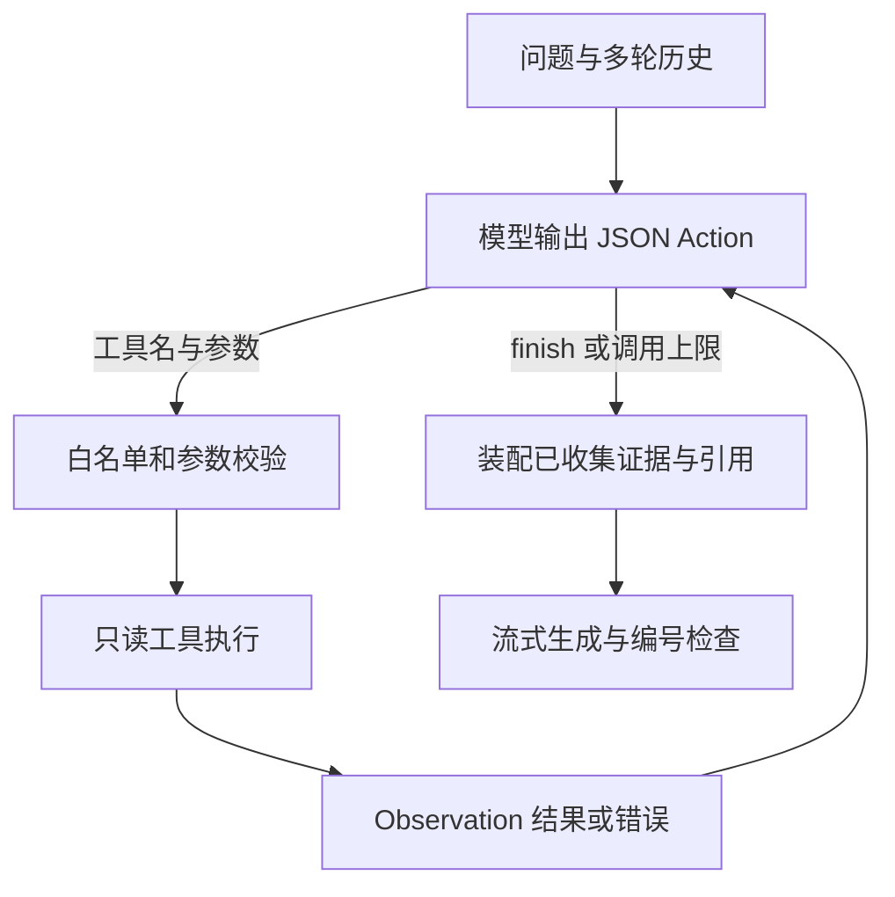

# 本项目的 ReAct Agent

真实模型的默认问答使用 ReAct：模型根据用户问题选择行动，程序执行工具并把观察结果返回给模型，模型再决定继续查询或结束。循环基于 LangGraph，检索完成后统一装配引用，最后生成真实流式答案。



## 工具与数据来源

| 工具 | 参数与行为 |
| --- | --- |
| text_search | query、可选 person；真实 BGE + BM25，支持按人物过滤，使用版本化 Redis 缓存 |
| person_profile | name；查询人物结构化属性 |
| graph_neighbors | name、relation、direction；查询入向或出向关系，返回明确 source / target |
| graph_path | source、target、max_hops；查询无向连接并检查跳数，不能解释为有向师承 |
| find_people | keyword、attribute、offset、limit；领域或籍贯字符串匹配，返回总数与分页名单 |

teacher 关系为学生→老师；student 关系为老师→学生。人物、关系和属性由数据库关系表提供，在请求快照中通过 NetworkX 查询。工具不会自动抽取新上传文档的人物关系。

## Action / Observation 协议

模型只返回一条结构化动作，例如：

```json
{"action":"graph_neighbors","arguments":{"name":"苏步青","relation":"teacher","direction":"out"}}
```

工具返回空关系时，模型可以接着选择：

```json
{"action":"text_search","arguments":{"query":"苏步青的导师与求学经历","person":"苏步青"}}
```

证据足够或无法继续补充时输出 `{"action":"finish","arguments":{}}`。结束动作不直接作为最终答案；最终答案由独立生成阶段结合已编号证据输出，保证非流式和 SSE 共用同一份证据。

这里采用兼容现有模型接口的 JSON 动作协议，并未使用供应商原生 function calling。它仍是模型决定工具并基于观察继续行动的 ReAct 循环；与旧版固定“改写→路由→检索”流程不同。

## 预算、错误与证据

- 默认最多 4 次工具尝试。无效 JSON、未知工具、非法参数和重复调用均消耗预算，并作为错误观察供模型修正。
- 工具全部只读，参数使用 Pydantic 校验；不能执行任意代码、SQL、文件操作或网络请求。
- 默认最多收集 12 条去重证据，每次观察有长度上限；最终答案只基于已收集的证据。
- 达到上限后使用已有证据生成答案；没有证据时上下文明确为空，提示模型承认无法确定。
- 关闭图谱增强时，图谱工具在执行层被禁用；文本检索仍可使用。
- 多轮历史传入决策阶段，模型据此填写新的检索参数。

## 轨迹和用量

API 返回 agent_trace、agent_stop；页面展示工具名、参数、状态、执行耗时和已收集证据数。不会请求或保存内部思维链。每次模型决策以及最终生成都计入同一轮 token 用量。

迁移 0002_agent_metadata 为 messages 增加 JSON 字段，保存公开工具轨迹和执行器信息；老会话得到空对象，原文、引用和历史消息保留。旧 SQLite 离线库在 create_schema 模式下兼容补齐字段；PostgreSQL 使用 Alembic。


## 入口与测试

默认 mode=agent、engine=auto 在真实模型下使用 ReAct；离线 stub 使用规则流程。tests/test_react.py 验证观察传递、工具调用、预算终止、关系方向、空查询和轨迹持久化。
